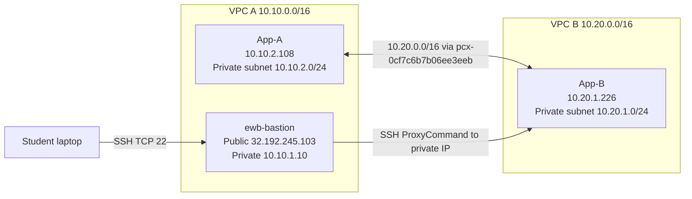

# AWS VPC Peering Architecture

Region: us-east-1 (N. Virginia)

## Verified identifiers

- VPC A: `vpc-094290dd996bdde79` — `10.10.0.0/16`
- VPC B: `vpc-05463d53d9e3da06c` — `10.20.0.0/16`
- VPC peering: `pcx-0cf7c6b7b06ee3eeb` (observed Active)
- VPC A public route table: `rtb-0bffd516469dc9220`
- VPC A private route table: `rtb-0df315a397a97459a`
- VPC B private route table: `rtb-0e04e73e930ddf38c`

The route tables must include reciprocal peering routes. The public route table also has `0.0.0.0/0` pointing to the Internet Gateway. Actual App-A and App-B addresses above differ from the sample addresses in the workbook; the diagram uses observed values. Verify current resources before submission.