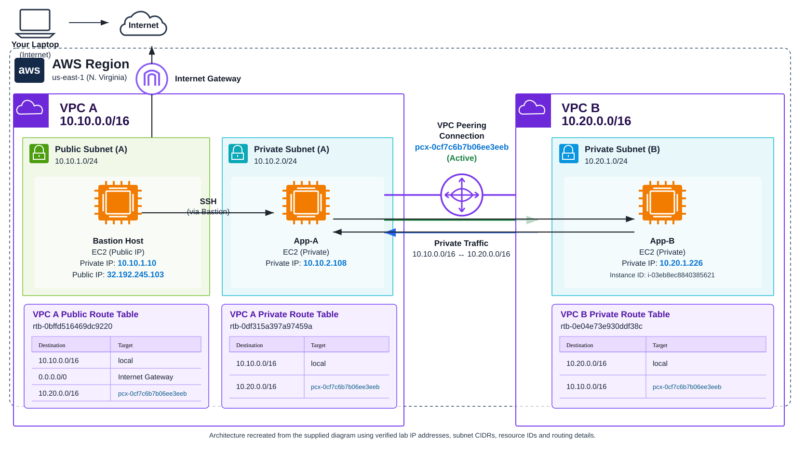
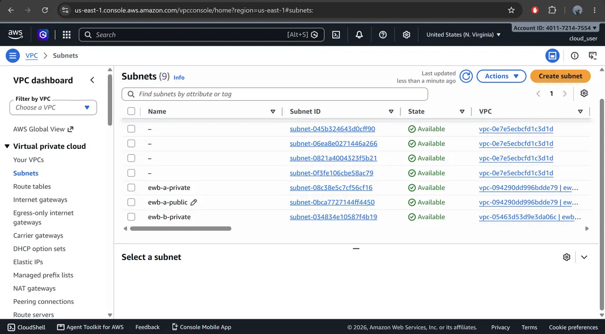
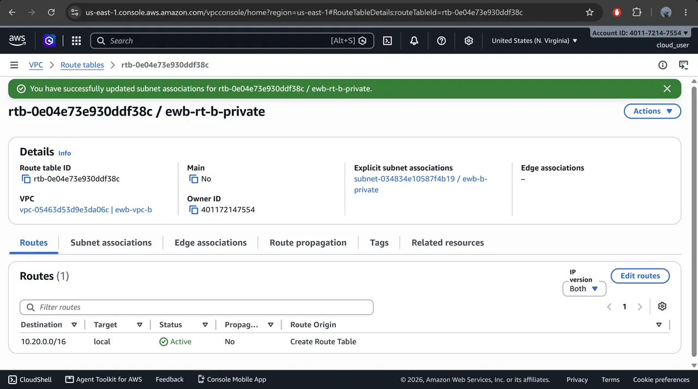
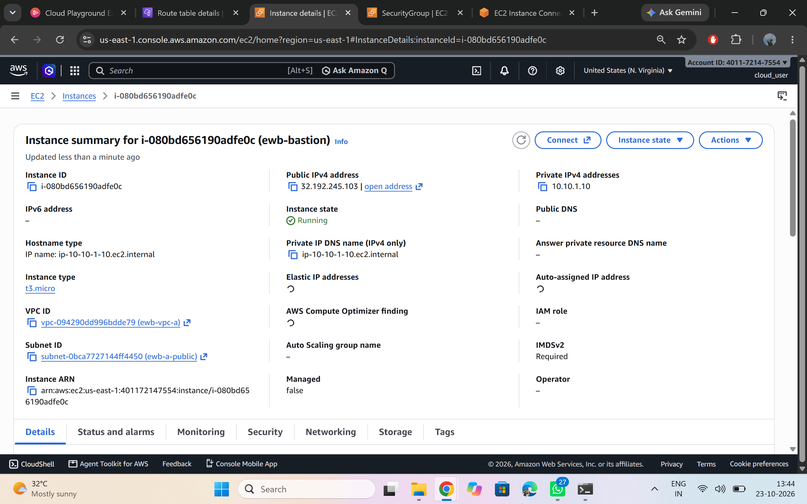
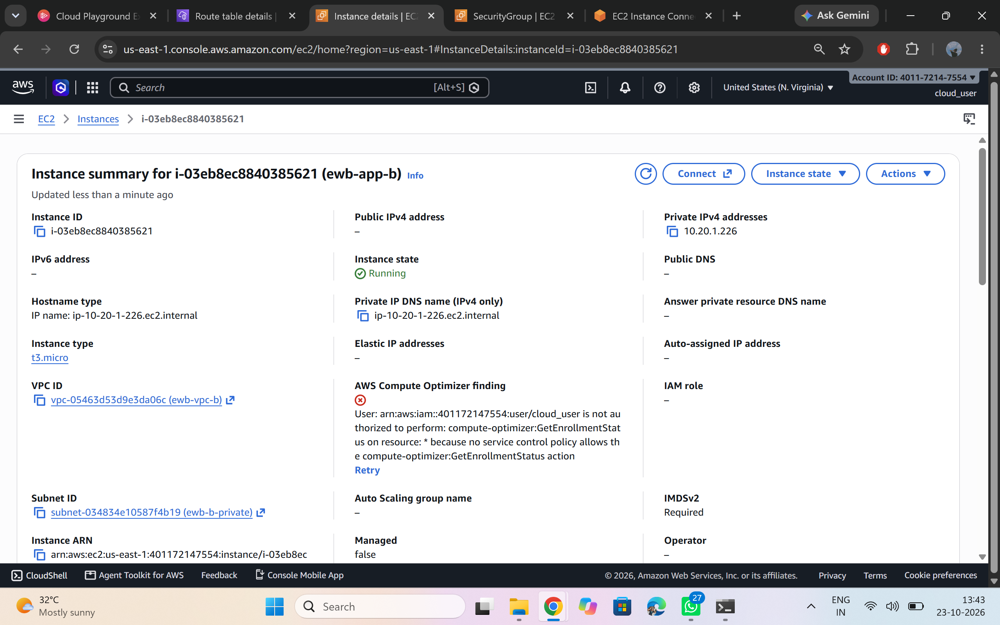
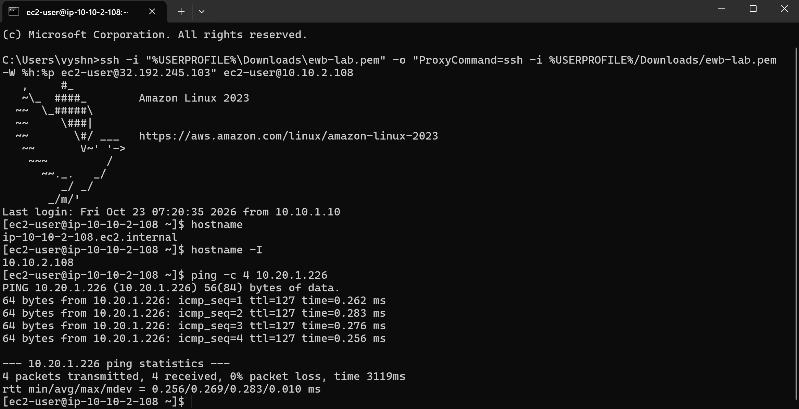

# AWS VPC Peering Project — EWB

A hands-on AWS networking project demonstrating private connectivity between two VPCs using an active VPC peering connection, reciprocal route-table entries, security groups, and a bastion host.

## Architecture

**Region:** US East (N. Virginia), `us-east-1`

## Verified AWS environment

| Resource | CIDR / IP | Resource ID |
|---|---|---|
| VPC A | `10.10.0.0/16` | `vpc-094290dd996bdde79` |
| VPC B | `10.20.0.0/16` | `vpc-05463d53d9e3da06c` |
| VPC A public subnet | `10.10.1.0/24` | `subnet-0bca7727144ff4450` |
| VPC A private subnet | `10.10.2.0/24` | `subnet-08c38e5c7cf56cf16` |
| VPC B private subnet | `10.20.1.0/24` | `subnet-034834e10587f4b19` |
| Bastion EC2 | Private `10.10.1.10`; public `32.192.245.103` | `i-080bd656190adfe0c` |
| App-A EC2 | Private `10.10.2.108`; no public IPv4 observed | `i-005788d06eff77db3` |
| App-B EC2 | Private `10.20.1.226`; no public IPv4 observed | `i-03eb8ec8840385621` |
| VPC peering | Active | `pcx-0cf7c6b7b06ee3eeb` |

These are the actual values observed in the lab screenshots, not the sample address ranges shown in the original sketch.

## Route tables

| Route table | Destination | Target |
|---|---|---|
| VPC A public — `rtb-0bffd516469dc9220` | `10.10.0.0/16` | `local` |
| | `0.0.0.0/0` | Internet Gateway |
| | `10.20.0.0/16` | `pcx-0cf7c6b7b06ee3eeb` |
| VPC A private — `rtb-0df315a397a97459a` | `10.10.0.0/16` | `local` |
| | `10.20.0.0/16` | `pcx-0cf7c6b7b06ee3eeb` |
| VPC B private — `rtb-0e04e73e930ddf38c` | `10.20.0.0/16` | `local` |
| | `10.10.0.0/16` | `pcx-0cf7c6b7b06ee3eeb` |

## Key implementation details

- **SSH path:** laptop → bastion public IP → private instances through a ProxyCommand/jump connection.
- **App-B inbound rules shown in the evidence:** SSH TCP/22 from `10.10.1.10/32` and ICMP Echo Request from `10.10.0.0/16`.
- **Forward and return routing:** VPC A routes `10.20.0.0/16` to the peering connection; VPC B routes `10.10.0.0/16` back through the same connection.
- **Security:** keep the PEM key on your laptop. Never commit PEM files, AWS credentials, or access tokens.

## Test results recorded

| Test | Observed result |
|---|---|
| VPC peering status | Active |
| SSH to App-B via bastion | Successful shell on App-B |
| App-B → App-A ping | 4 replies, 0% packet loss |
| Controlled ICMP rule test | Packet loss while the inbound ICMP rule was removed; connectivity returned after the rule was restored |

## Evidence screenshots

The repository keeps **12 selected screenshots** rather than a large dump of repeated captures.

### Network and routing

### EC2 and security configuration

### Connectivity proof

## Project report

See [`report/PROJECT_REPORT.md`](report/PROJECT_REPORT.md) for the longer implementation report and cleanup checklist.

## Before submission

Name: VENTRAPRAGADA VENKATA SUBBARAO
Batch: AWS INTERNSHIP BATCH 1.1
